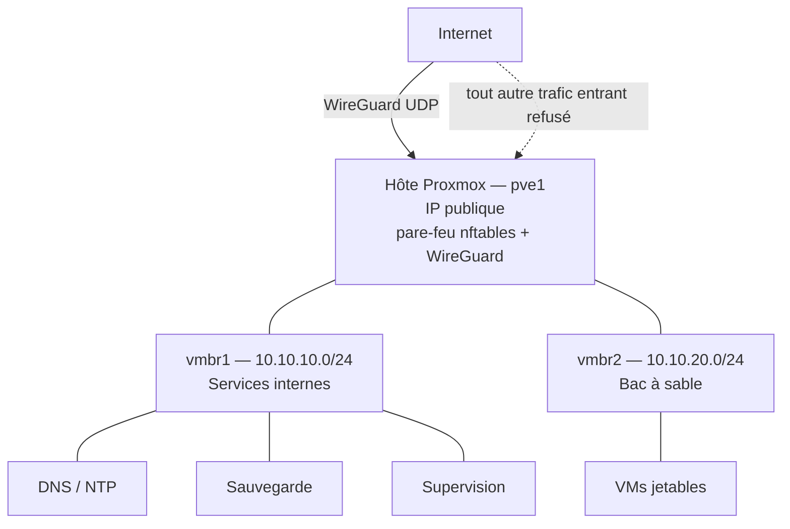

# homelab

Infrastructure personnelle de test que je monte en autodidacte pour me remettre à niveau en administration système.

Ce dépôt contient l'architecture, les choix techniques et le journal de bord. Les projets qui produisent du code réutilisable ont leur propre dépôt, listé plus bas.

**État : en construction.** La section [Avancement](#avancement) indique ce qui est réellement déployé.

---

## Contexte

J'ai suivi deux ans et demi de BUT Réseaux & Télécommunications parcours Cybersécurité, dont un peu plus d'un an en apprentissage comme administrateur système. Depuis, je travaille dans le support informatique. Je n'ai plus pratiqué l'administration système au quotidien.

Ce lab me sert à reprendre cette pratique sur une vraie infrastructure, et à documenter ce que je fais au fur et à mesure. Je m'impose une règle : tout ce que je déploie doit être documenté, reproductible, et restaurable après destruction complète.

---

## Choix d'hébergement

J'ai loué un serveur dédié plutôt que d'acheter du matériel.

Raisons : la machine est disponible en permanence sans dépendre de mon domicile, le lien réseau est à 1 Gbit/s symétrique, et le coût mensuel est fixe.

Ce que ça implique, et que j'assume :

- Je n'ai pas d'accès physique. Une erreur de configuration réseau peut me couper l'accès. Le fournisseur met à disposition un système de secours et une console distante si besoin.
- Je n'ai pas de matériel réseau réel. La segmentation est virtuelle, donc pas de VLAN sur switch physique.
- La machine est directement exposée sur Internet. C'est la contrainte principale de ce lab : le durcissement et le contrôle des accès viennent en premier.

---

## Matériel

| | |
|---|---|
| Modèle | Hetzner AX41-1-LTD |
| CPU | AMD Ryzen 5 3600, 6 cœurs / 12 threads |
| RAM | 64 Go DDR4 |
| Stockage | 2 x 512 Go NVMe en RAID 1 logiciel (mdadm), ext4 |
| Réseau | 1 Gbit/s, IPv4 publique + préfixe IPv6 |
| Hyperviseur | Proxmox VE 8 |

---

## Architecture cible

### Plan d'adressage

| Réseau | Plage | Passerelle | Usage |
|---|---|---|---|
| interface physique | IP publique | fournisseur | Hôte uniquement |
| vmbr1 | 10.10.10.0/24 | 10.10.10.1 | Services d'infrastructure |
| vmbr2 | 10.10.20.0/24 | 10.10.20.1 | Tests destructifs |
| wg0 | 10.10.0.0/24 | 10.10.0.1 | Accès d'administration |

Réservations : `.1` pour la passerelle, `.2` à `.9` pour l'infrastructure fixe, `.10` et suivantes pour les services.

### Règles que je m'impose

1. **Aucune VM sur l'interface publique.** Le fournisseur ne route qu'une seule adresse MAC sur mon port. Une VM posée sur un bridge relié à l'interface physique enverrait des trames avec sa propre MAC, ce qui provoque un blocage du trafic et un signalement pour abus. Les VMs sont donc sur des réseaux privés avec une sortie Internet par NAT.
2. **L'interface web de Proxmox n'est pas joignable depuis Internet.** Elle écoute uniquement sur la boucle locale et j'y accède par tunnel SSH. Aucun port supplémentaire n'est ouvert.
3. **Le bac à sable ne communique pas avec les services internes.**
4. **Deux niveaux de filtrage.**

---

## Inventaire des VMs

| Nom | Rôle | OS | Réseau | Adresse | Type | État |
|---|---|---|---|---|---|---|
| — | — | — | — | — | — | — |

Une ligne apparaît ici quand la VM existe réellement.

---

## Feuille de route

| # | Sujet | Dépôt | État |
|---|---|---|---|
| 1 | Architecture et documentation | ce dépôt | En cours |
| 2 | Installation de Proxmox, accès d'administration par VPN | — | Prévu |
| 3 | Template de VM Debian durcie | — | Prévu |
| 4 | Segmentation réseau et filtrage | — | Prévu |
| 5 | Services d'infrastructure : DNS, NTP | — | Prévu |
| 6 | Sauvegarde externalisée et restauration testée | — | Prévu |
| 7 | Supervision et centralisation des logs | — | Prévu |
| 8 | Automatisation avec Ansible | — | Prévu |

J'ai choisi cet ordre volontairement. L'accès sécurisé et le socle durci passent en premier parce que la machine est exposée dès le premier jour.

---

## Avancement

| Date | Étape |
|---|---|
| 2026-08-20 | Serveur livré, durcissement SSH, installation de Proxmox VE sur `pve1` |

Le détail des sessions est dans [journal.md](journal.md).
