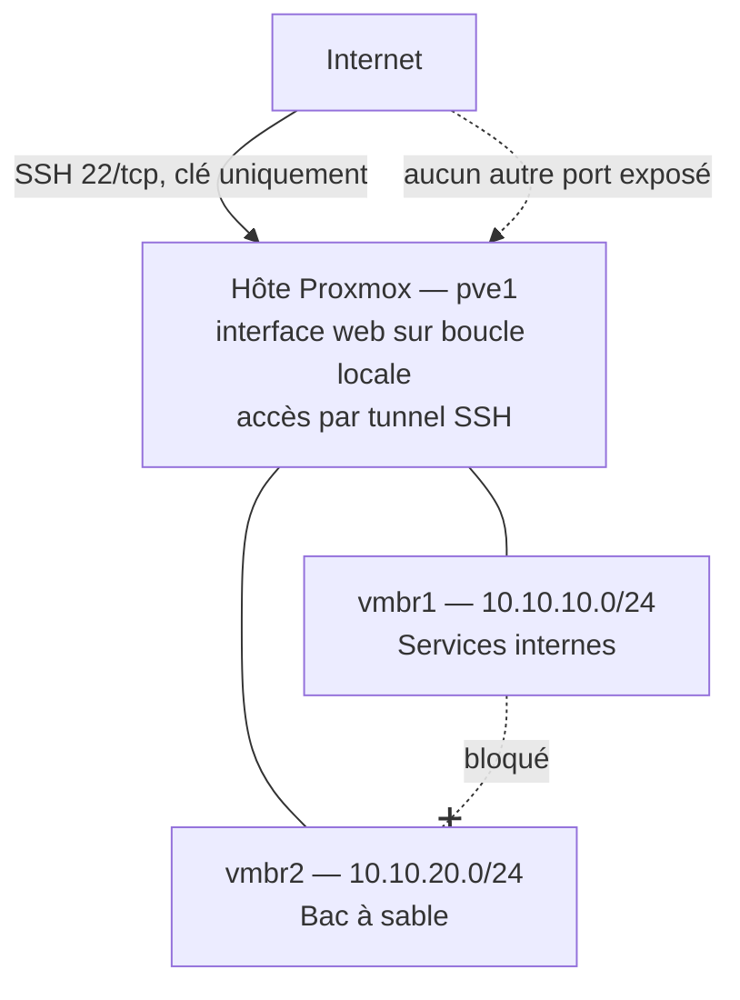

# homelab

Infrastructure personnelle de test que je monte en autodidacte pour me remettre à niveau en administration système. En clair : j'ai loué un serveur, je le sécurise et je documente chaque étape, y compris mes erreurs.

Ce dépôt contient l'architecture, les choix techniques, les fichiers de configuration réellement en place et le journal de bord. Les projets qui produisent du code réutilisable auront leur propre dépôt, listé plus bas.

**État : en construction.** La section [Avancement](#avancement) indique ce qui est réellement déployé.

---

## En bref

| | |
|---|---|
| Ce que c'est | Un serveur dédié Hetzner sous Proxmox VE, exposé sur Internet, que je durcis et segmente moi-même |
| Ce qui est en place | Accès SSH par clé uniquement, interface Proxmox non exposée (tunnel SSH), deux réseaux internes avec NAT, bac à sable isolé par filtrage |
| Ce qui n'est pas encore là | VM, sauvegarde externalisée, supervision, automatisation (voir la [feuille de route](#feuille-de-route)) |

**Par où commencer :**

- [Incident rpcbind](docs/incidents/2026-09-rpcbind.md) : un port exposé signalé par le BSI, de la cause à la correction vérifiée depuis l'extérieur.
- [Filet de sécurité réseau](docs/procedures/filet-reseau.md) : comment je modifie la configuration réseau d'une machine dont je n'ai pas l'accès physique.
- [Journal de bord](journal.md) : mes notes de session, avec les décisions, leurs contreparties et mes erreurs.

---

## Contexte

J'ai suivi un BUT Réseaux & Télécommunications parcours Cybersécurité, dont un peu plus d'un an en apprentissage comme administrateur système. Depuis, je travaille dans le support informatique. Je n'ai plus pratiqué l'administration système au quotidien.

Ce lab me sert à reprendre cette pratique sur une vraie infrastructure, et à documenter ce que je fais au fur et à mesure. Je m'impose une règle : tout ce que je déploie doit être documenté, reproductible, et restaurable après destruction complète.

---

## Choix d'hébergement

J'ai loué un serveur dédié plutôt que d'acheter du matériel.

Raisons : la machine est disponible en permanence sans dépendre de mon domicile, le lien réseau est à 1 Gbit/s symétrique, et le coût mensuel est fixe.

Ce que ça implique, et que j'assume :

- Je n'ai pas d'accès physique. Une erreur de configuration réseau peut me couper l'accès. Avant chaque intervention sur le réseau, j'arme un retour arrière automatique (voir [procédure](docs/procedures/filet-reseau.md)).
- Je n'ai pas de matériel réseau réel. La segmentation est virtuelle, donc pas de VLAN sur switch physique.
- La machine est directement exposée sur Internet. C'est la contrainte principale de ce lab : le durcissement et le contrôle des accès viennent en premier, pas à la fin. Le [signalement reçu en septembre](docs/incidents/2026-09-rpcbind.md) l'a confirmé.

---

## Matériel

| | |
|---|---|
| Modèle | Hetzner AX41-1-LTD |
| CPU | AMD Ryzen 5 3600, 6 cœurs / 12 threads |
| RAM | 64 Go DDR4 |
| Stockage | 2 x 512 Go NVMe en RAID 1 logiciel (mdadm), ext4 |
| Réseau | 1 Gbit/s, IPv4 publique + préfixe IPv6 |
| Hyperviseur | Proxmox VE 8, installé sur Debian 12 |

Le RAID 1 protège contre la panne d'un disque, rien d'autre. Une suppression ou un chiffrement malveillant est répliqué sur les deux disques immédiatement. Il ne remplace pas une sauvegarde externalisée.

---

## Architecture

### État actuel



Les deux réseaux internes existent et sortent sur Internet par NAT. Aucune VM n'est encore déployée.

### Cible

Accès d'administration par VPN WireGuard, services d'infrastructure sur `vmbr1` (DNS, NTP, sauvegarde, supervision), VMs jetables sur `vmbr2`.

### Plan d'adressage

| Réseau | Plage | Passerelle | Usage | État |
|---|---|---|---|---|
| interface physique | IP publique | fournisseur | Hôte uniquement | En place |
| vmbr1 | 10.10.10.0/24 | 10.10.10.1 | Services d'infrastructure | En place |
| vmbr2 | 10.10.20.0/24 | 10.10.20.1 | Tests destructifs | En place |
| wg0 | 10.10.0.0/24 | 10.10.0.1 | Accès d'administration | Prévu |

Réservations : `.1` pour la passerelle (l'hôte), `.2` à `.9` pour l'infrastructure fixe, `.10` et suivantes pour les services.

### Ports exposés sur Internet

| Port | Service | Remarque |
|---|---|---|
| 22/tcp | SSH | Authentification par clé uniquement |

Tout le reste écoute sur la boucle locale. Depuis l'incident rpcbind, je le vérifie avec `ss -tulnp` (TCP **et** UDP) après chaque installation importante.

Contrôle depuis l'extérieur le 2026-10-24, en IPv4 uniquement (l'IPv6 n'a pas été testé) : un scan TCP complet ne montre que le port 22 ouvert, et le port 111 est fermé en UDP (voir l'[incident](docs/incidents/2026-09-rpcbind.md)).

### Règles que je m'impose

1. **Aucune VM sur l'interface publique.** Le fournisseur ne route qu'une seule adresse MAC sur mon port. Une VM posée sur un bridge relié à l'interface physique enverrait des trames avec sa propre MAC, ce qui provoque un blocage du trafic et un signalement pour abus. Les bridges internes sont donc déclarés avec `bridge-ports none`, et les VMs sortent par NAT.
2. **L'interface web de Proxmox n'est pas joignable depuis Internet.** Elle écoute uniquement sur la boucle locale et j'y accède par tunnel SSH.
3. **Le bac à sable ne communique pas avec les services internes.** Le routage est global sur l'hôte, donc la séparation vient du filtrage : chaîne `forward` en refus par défaut, seul le trafic vers Internet est autorisé.
4. **Quand c'est possible, je n'édite pas les fichiers qui appartiennent à un paquet ou au fournisseur.** J'ajoute les miens dans les répertoires `.d` prévus pour ça, ou je passe par une surcharge systemd. Les mises à jour ne peuvent pas écraser mes modifications. Une exception : `/etc/default/rpcbind`, modifié directement par simplicité. Une surcharge du service aurait été plus propre (voir l'[incident](docs/incidents/2026-09-rpcbind.md)).
5. **Je ne publie aucune donnée de ciblage.** Pas d'adresse IP publique, pas de nom d'hôte réel, pas de clé. Les adresses publiques sont remplacées par `203.0.113.1`.

### Ce qui n'est pas encore durci

Je préfère le lister ici plutôt que de laisser croire que c'est fait :

- La chaîne `input` du pare-feu de l'hôte est en `policy accept`. Rien n'est exposé aujourd'hui parce que les services écoutent sur la boucle locale, mais un nouveau service mal configuré le serait. C'est la prochaine étape.
- L'administration se fait encore en root.
- La configuration de l'hôte n'est pas sauvegardée ailleurs que dans ce dépôt.
- `rpcbind` tourne toujours, restreint à la boucle locale, parce que Proxmox en dépend (voir l'[incident](docs/incidents/2026-09-rpcbind.md)).

---

## Contenu du dépôt

```
homelab/
├── README.md
├── journal.md                 notes brutes, session par session
├── configs/
│   └── pve1/                  fichiers en place sur l'hôte, même arborescence que /
│       └── etc/
│           ├── default/
│           ├── network/interfaces.d/
│           ├── nftables.conf
│           ├── ssh/sshd_config.d/
│           ├── sysctl.d/
│           └── systemd/system/
└── docs/
    ├── procedures/            méthodes réutilisables
    │   └── filet-reseau.md
    └── incidents/             comptes rendus d'incident
        └── 2026-09-rpcbind.md
```

Les fichiers de `configs/` reprennent le chemin exact qu'ils ont sur la machine. Pas besoin d'expliquer où chacun va.

---

## Inventaire des VMs

| Nom | Rôle | OS | Réseau | Adresse | Type | État |
|---|---|---|---|---|---|---|
| — | — | — | — | — | — | — |

Une ligne apparaît ici quand la VM existe réellement.

---

## Feuille de route

| # | Sujet | Dépôt | État |
|---|---|---|---|
| 1 | Architecture et documentation | ce dépôt | En cours |
| 2 | Installation de Proxmox et durcissement de l'hôte | ce dépôt | En cours |
| 3 | Réseau : bridges internes, NAT, segmentation | ce dépôt | Fait |
| 4 | Template de VM Debian durcie | — | Prévu |
| 5 | Services d'infrastructure : DNS, NTP | — | Prévu |
| 6 | Sauvegarde externalisée et restauration testée | — | Prévu |
| 7 | Supervision et centralisation des logs | — | Prévu |
| 8 | Automatisation avec Ansible | — | Prévu |

J'ai choisi cet ordre volontairement. L'accès sécurisé et le socle durci passent en premier parce que la machine est exposée dès le premier jour. La sauvegarde passe avant la supervision, parce qu'une infrastructure que je ne sais pas restaurer n'a pas besoin d'être surveillée.

---

## Ce que ce lab ne couvre pas

- Un seul nœud, donc pas de haute disponibilité, pas de cluster, pas de bascule.
- Pas de matériel réseau physique, donc pas de VLAN sur switch ni de routage inter-sites réel.
- Pas de contrainte de production : pas d'utilisateurs, pas d'engagement de service, pas de fenêtre de maintenance à respecter.

---

## Avancement

| Date | Étape |
|---|---|
| 2026-08-20 | Serveur livré, durcissement SSH, installation de Proxmox VE sur `pve1` |
| 2026-09-08 | Bridges internes `vmbr1` et `vmbr2`, routage IPv4, NAT |
| 2026-09-11 | Isolation de `vmbr2` par filtrage |
| 2026-09-16 | Signalement Hetzner / BSI : port 111 exposé, voir l'[incident](docs/incidents/2026-09-rpcbind.md) |
| 2026-09-19 | `rpcbind` restreint à la boucle locale, seul SSH reste exposé |
| 2026-10-24 | Contrôle depuis l'extérieur, en IPv4 : seul SSH est ouvert |

Le détail des sessions est dans [journal.md](journal.md).